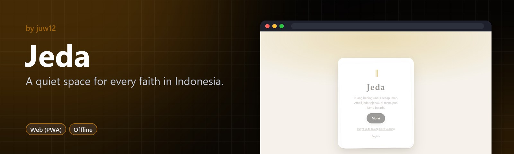
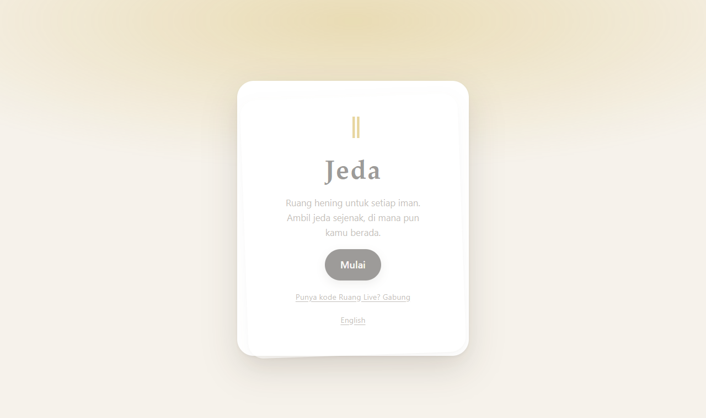

<!-- HERO:START -->
<p align="center">
  <a href="https://juw12.github.io/jeda/"></a>
</p>

<p align="center">
  <b>A quiet space for every faith in Indonesia.</b><br>
  A virtual place of stillness and a living library of teachings, rituals and holy days. No account needed.
</p>

<p align="center">
  <a href="https://juw12.github.io/jeda/"><b>Try it live</b></a> ·
  <a href="#see-it-in-action">See it in action</a> ·
  <a href="#highlights">Highlights</a> ·
  <a href="https://github.com/juw12">More by juw12</a>
</p>

<p align="center">
  <a href="https://github.com/juw12/jeda"></a>
  <a href="https://juw12.github.io/jeda/"></a>
  
  
</p>

<a id="highlights"></a>
<table>
  <tr>
    <td width="33%" valign="top">
      <b>Your own quiet space</b><br>
      Light incense or a candle in your space and visit others' spaces respectfully.
    </td>
    <td width="33%" valign="top">
      <b>A living library</b><br>
      Teachings and rituals per stream and dialect, reviewed in the open by verified clergy.
    </td>
    <td width="33%" valign="top">
      <b>Holy days and memorials</b><br>
      Imlek, Hijri and Pawukon calendars plus family memorial dates.
    </td>
  </tr>
</table>

## See it in action

<p align="center">
  <a href="https://juw12.github.io/jeda/"></a><br>
  <sub>Open the interactive demo at <a href="https://juw12.github.io/jeda/">juw12.github.io/jeda/</a></sub>
</p>
<!-- HERO:END -->

## About

Ruang hening virtual dan pustaka untuk setiap iman di Indonesia: Islam, Kristen Protestan, Katolik, Hindu, Buddha, dan Khonghucu & tradisi Tionghoa (flagship), plus Ruang Alam tanpa agama.

Terinspirasi oleh "Sansa" (산사), kuil virtual dari Korea. Dibuat oleh [juw12](https://github.com/juw12).

## Fitur

| Fitur | Isi |
|---|---|
| **Mulai** | Pertanyaan awal satu kartu per layar: suasana hati, jalan iman, aliran, dialek keluarga, nama tamu & warna jubah, sendiri atau bersama |
| **Ruang 3D** | 7 tempat 3D yang bisa dijelajahi (WebGL, three.js): jalan dengan ketuk/WASD atau chip "Pergi ke", lalu lakukan kegiatan di tempatnya — tancapkan hio, gantung lampion, bakar kim cua, nyalakan lilin/dupa, letakkan teratai, haturkan canang (warna Nawa Sanga), berwudu, bunyikan lonceng/genta, duduk berzikir 33×3, rosario, meditasi, napas. Jatuh kembali ke gambar 2D bila WebGL tidak ada |
| **Hitungan setiap aksi** (v1.7) | Setiap kegiatan dihitung: butir tasbih/mala/rosario tampil sebagai "📿 12 / 33" di atas kepala dan di HUD, begitu juga berwudu, menyalakan lilin, salam, pesan makanan, bersedekah — "🪙 Beri uang receh ×3" |
| **Rekening amal (karma)** (v1.7) | Saldo kebaikan seperti rekening bank: kebaikan menambah (bersedekah ke pengemis, menyapa, belajar, beribadah — dengan batas harian), keburukan mengurangi (mengusir pengemis, kata kasar, menerobos area suci). Ada buku besar & tabel hitungan |
| **Pengemis & sedekah** (v1.7) | Pak Darto (serambi tempat ibadah) dan Mbah Sumi (kedai) — beri receh, belikan makanan, sapa, atau tolak dengan sopan; koin jatuh ke mangkuk |
| **Harapan** (v1.7) | Saldo kebaikan dipakai untuk "mewujudkan" harapan simbolis: lentera terbang, hujan kelopak, kunang-kunang, pita di Pohon Harapan rumah, mentraktir orang di kedai. Bukan jual-beli pahala — hanya pengingat untuk terus berbuat baik |
| **Sekolah Iman** (v1.7) | 8 pelajaran pengantar (enam agama, kepercayaan, lintas iman) dengan 40 soal kuis; selesai membaca +3, lulus kuis +10 |
| **Wisata Iman — 7 Keajaiban** (v1.7) | Borobudur, Prambanan, Istiqlal ↔ Katedral Jakarta, GPIB Immanuel (Gereja Blenduk), Sam Poo Kong, Wae Rebo — tempat 3D stilistik dengan pemandu, fakta, etika berkunjung, dan aktivitas ibadah; perjalanan pertama gratis, berikutnya 15 kebaikan, tiket disimpan. Disinari lampu sorot di malam hari |
| **Suara di iPhone** (v1.7) | Audio dibuka dengan sentuhan pertama (termasuk iOS lama & mode senyap via sesi "playback"), dilanjutkan otomatis saat kembali ke aplikasi |
| **Kontrol kaca & joystick** (v1.7.1) | Tombol di ruang 3D kini kecil dan tembus pandang (kaca gelap tipis) agar pemandangan tetap utama; di layar sentuh ada joystick transparan di kiri bawah — geser untuk berjalan, lepas untuk berhenti (keyboard & ketuk-untuk-berjalan tetap bisa) |
| **Kaca terbaca & hint rapi** (v1.7.2) | Kaca tombol kini meredupkan latar di belakangnya, jadi label putih tetap terbaca (kontras ≥ 4,5:1) bahkan di atas dinding putih atau langit terang; semua tombol minimal 24×24 px; petunjuk "Ketuk tanah…" pindah ke atas deretan chip, tidak lagi menutupi tombol Ibadah/Kedai/Rumah, dan hilang begitu kamu menyentuh layar |
| **Nama tetap di layar** (v1.7.3) | Label nama NPC, gelembung sapaan & obrolan, dan hitungan di atas kepala kini bergeser ke dalam saat tokoh berdiri di tepi layar — tidak lagi terpotong, terutama di ponsel |
| **HUD yang lebih tenang** (v1.7.4) | Di ponsel judul dan tombol Sendiri/Siarkan kini satu baris, saldo kebaikan pindah ke bilah atas (satu saldo saja), Salam terlipat dan duduk di depan deretan chip, judul tempat memakai kaca yang sama dengan tombol lain, dan joystick ikut berkaca - pemandangan 3D lebih lapang |
| **HUD dua baris** (v1.7.5) | Di ponsel pemilih tempat (Ibadah/Kedai/Rumah) dan tombol Sendiri/Siarkan kini satu baris di bawah bilah atas, notifikasi tidak lagi menimpa tombol, petunjuk jalan muat satu baris, label tombol samping (Panduan) tidak terpotong, dan semua tombol kaca punya tepi yang terlihat di adegan malam |
| **Kaca yang seragam** (v1.7.6) | Bilah tab di dalam ruang kini memakai kaca yang sama dengan tombol lain, label tombol samping (Panduan) muat di tombolnya juga di desktop, dan joystick ponsel sedikit lebih ringkas |
| **Menu ⋯ di ponsel** (v1.7.7) | Di ponsel, Sendiri, Siarkan, ganti waktu, dan layar penuh kini terlipat dalam satu tombol ⋯ (titik hijau saat kamu sedang bersama orang lain); deretan tombol samping tinggal 1P dan Panduan, jadi ruang 3D lebih lapang. Di desktop semuanya tetap terlihat |
| **Tombol › & label tak menutupi kontrol** (v1.7.8) | Di ponsel, deretan tempat kini punya tombol › yang muncul hanya bila masih ada pilihan tersembunyi (ketuk untuk menggeser), jadi chip terakhir tidak lagi terpotong; label nama pemain otomatis memudar saat berada di balik joystick, tombol samping, atau bilah bawah; kenop joystick lebih terang |
| **Chip utuh & cari di kaca** (v1.7.9) | Di ponsel, deretan tempat kini berhenti di chip terakhir yang muat utuh — tidak ada lagi label terpotong seperti "Membaca & mere…" atau chip pudar yang tampak nonaktif; tombol › menggeser tepat ke chip berikutnya. Tombol cari ⌕ kini punya latar kaca agar tetap terlihat di langit terang, judul ruang di desktop lebih ringkas, dan petunjuk awal memudar lebih cepat |
| **Atap kedai yang terbaca** (v1.7.11) | Kamera kedai kini dibuka setinggi mata di bawah emperan, jadi yang terlihat pertama adalah warung yang terang, papan kios, dan lampu hias di tepi atap (dulu kamera melihat dari atas atap, yang tampak seperti lempeng hitam di malam hari). Atapnya kini bertekstur seng/genteng bergelombang dan di bawahnya ada plafon terang (tripleks, atau anyaman bambu di kedai desa) |
| **Kaca terpilih & jarak lega** (v1.7.12–13) | Chip tempat yang terpilih dan menu ⋯ yang terbuka memakai kaca gelap yang sama dengan tombol lain, tombol benda yang dipegang memakai ikon garis, dan deretan tempat diberi jarak lebih lega (28px) dari bilah tab di ponsel |
| **Rumah dibuka dari teras** (v1.7.14) | Seperti kedai, kamera Rumah kini dibuka setinggi mata di depan teras, jadi ruang keluarga yang terang dan meja makan langsung terlihat; atap rumah tidak lagi menutupi separuh layar seperti lempeng gelap di malam hari |
| **Ruang penuh di layar lebar** (v1.7.15) | Di laptop dan desktop, ruang 3D kini memenuhi layar seperti di ponsel; salam dan kartu panduan ada tepat di bawahnya saat digulir, jadi tidak ada lagi pita krem terang yang memotong pemandangan malam |
| **Warna aksen yang terbaca** (v1.7.16) | Tautan, huruf kamus, label langkah, dan chip aktif kini memakai versi warna iman yang lebih pekat, jadi kontrasnya minimal 4,7:1 di tema terang dan 4,6:1 di tema gelap untuk kedelapan iman (dulu kuning Hindu hanya 1,6:1 di atas krem); tautan "Baca" di Kamus juga lebih mudah disentuh |
| **Kontras di dalam ruang 3D** (v1.7.17) | Tautan di panel, obrolan dengan tokoh, dan kartu aksi di dalam ruang 3D kini memakai warna iman yang pekat (dulu tautan kuning Hindu di panel hanya 2,7:1), gelembung obrolan Anda memakai teks gelap di atas warna iman yang lebih muda (dulu teks putih di atas kuning 1,9:1), dan garis fokus papan ketik kini terlihat jelas di kedelapan iman; semua minimal 5:1 |
| **Ikon garis & satu jenis kaca** (v1.7.10) | Tombol samping 1P/3P, waktu, dan Panduan kini memakai ikon garis yang tampil sama di semua ponsel (bukan emoji yang berbeda-beda per sistem), dan pengalih Ibadah/Kedai/Rumah memakai kaca gelap yang sama seperti tombol lain |
| **Kedai per iman** (v1.6) | Tiap ruang punya tempat makan khas: Pujasera Pecinan (Khonghucu), Kopitiam & Kedai Vegetarian (Buddha), RM Padang & Warung Halal (Islam), Warung Bali (Hindu), Lapo & Kedai Kopi Batak/Manado (Protestan), Kedai Flores (Katolik), Angkringan (Alam). Penjual memasak langsung dengan cara tradisional (wajan & api, arang & kipas, kukusan bambu, tarik teh, ulek, griddle) — bisa ditonton dari dekat. Pesan dari menu → **Makan di sini** (duduk di meja) atau **Bungkus** (dibawa, bisa dimakan di rumah) |
| **Makan ASMR** (v1.6) | Sudut pandang orang pertama di meja: hidangan prosedural seukuran asli (butir nasi, mi, kuah berminyak, uap), sumpit/sendok/tangan sesuai hidangan, animasi suapan, kuah berkurang, suara ASMR sintetis (kriuk, seruput, kunyah, denting) dengan pengatur volume. Doa sebelum makan sesuai iman pengguna |
| **Rumah per iman** (v1.6) | Rumah keluarga dengan altar khas: meja abu + altar Tian, cetiya, musala + keran wudu, merajan + saiban, salib + Alkitab, altar rumah + Bunda Maria, pondok tanaman. Dapur, meja makan, rak keluarga & kotak surat |
| **Warga (NPC)** (v1.6) | Penjual, pengunjung, pejalan, umat, dan pemandu yang hidup tanpa internet: saling mengobrol dengan gelembung teks, menyapa saat didekati. Ketuk warga untuk obrolan ringan; pertanyaan tentang iman dijawab dari Pustaka dengan tautan sumber |
| **Panduan di dalam 3D** (v1.6) | Pustaka, Tanya, Kalender, Upacara, Kamus, Ibadah, Kunjungi (papan panduan di halaman tempat ibadah) serta Arsip, Peringatan, Syukur, Kartu (rak keluarga & kotak surat di rumah) dibuka sebagai panel di dalam ruang 3D. Tab Pustaka & Tanya dihapus; navigasi kini Beranda · Ruang · Lainnya |
| **Orang pertama & ketiga** | Semua area (tempat ibadah, kedai, rumah, dan makan) bisa dijelajahi dalam tampilan orang pertama maupun ketiga |
| **Salam khas tiap iman** | Bukan emoji: avatar memperagakan sikapnya dan mengucapkan salamnya — soja + Wei De Dong Tian / Xian You Yi De / Shanzai, cakupang tangan + Om Swastyastu, anjali + Namo Buddhaya / Sadhu, Assalamu'alaikum + tangan di dada, Syalom / Haleluya, Berkah Dalem / tanda salib. Tamu memakai salam netral (Salam hormat, Terima kasih, Salam damai) |
| **Hadir bersama** | Opsional: lihat dan sapa pengunjung lain di ruang yang sama secara langsung (peer-to-peer WebRTC, sinyal lewat relay Nostr publik, tanpa server Jeda, tanpa akun). Gerak, kegiatan, dan salam tersinkron. Tamu dari iman lain hanya mengamati ritual ibadah |
| **Ruang Live** | Untuk siaran TikTok/IG/YouTube: ketuk **Siarkan** di ruang → dapat kode 7 huruf (mis. K7QX2MA), tautan, dan QR. Penonton membuka tautan atau `juw12.github.io/jeda` → **Gabung** → ketik kode, isi satu kartu, langsung masuk 3D. Pemandu terverifikasi (kode diturunkan dari SHA-256 rahasia di perangkat pemandu), bisa memulai **Hening 1 menit** serentak, **Ajak ke sini**, **Mode siaran** (kode + QR besar di layar), dan **Akhiri**. Penonton dibagi ke 6 kelompok koneksi agar kuat untuk banyak orang; pemandu terlihat oleh semua |
| **3D di hampir semua perangkat** | Kualitas otomatis (HP lama: tanpa bayangan, resolusi 1×), turun sendiri bila FPS < 28, jatuh ke WebGL1 bila perlu, pulih dari GPU context lost. Pengaturan → Kualitas 3D |
| **Ruang (alat)** | 7 ruang (Klenteng, Vihara, Pura, Masjid, Gereja, Gereja & Gua Maria, Ruang Alam) dengan ritual interaktif: hio, ciam si + poe, kim cua, meja abu leluhur, namaskara 108, mala, canang sari, Tri Sandhya, tasbih, jadwal sholat, rosario (peristiwa sesuai hari), Angelus, lilin doa, meditasi, napas, ambience sintetis |
| **Kunjungi & Kenali** | Ruang iman lain dalam mode amati: ritual ditampilkan sebagai demonstrasi + etiket tamu |
| **Pustaka** | 8 bagian per agama (ajaran, kitab, ibadah harian, hari raya, siklus hidup, aturan, perbedaan aliran, sejarah), sumber, status tinjauan, variasi per aliran/dialek, laporan koreksi |
| **Tanya Jeda** | Jawaban hanya dari Pustaka dengan sitasi; mode gratis (pencarian di perangkat) atau mode AI opsional (Cloudflare Worker) |
| **Panduan Upacara** | Daftar persiapan yang bisa dicentang dan dicetak (Ceng Beng, Imlek, duka, Sangjit, Idulfitri, aqiqah, Waisak, Galungan, baptis, Natal) |
| **Kalender** | Imlek/Kongzili, Hijriah, Pawukon Bali, liturgi, titik matahari (Ceng Beng, Tang Ce) + tanggal resmi SKB 3 Menteri 2027 |
| **Rumah Ibadah** | Daftar tempat ibadah nyata; info donasi hanya untuk yang terverifikasi, langsung ke rumah ibadah |
| **Arsip Keluarga** | Catatan & rekaman suara tetua, tersimpan di perangkat, bisa diekspor |
| **Peringatan Arwah** | Hari ke-7/49/100 (adat Tionghoa), tahlilan 3/7/40/100/1000 & haul, misa arwah, ki-jit menurut tanggal Imlek/Hijriah/Masehi; simpan ke kalender HP |
| **Jurnal Syukur** | Catatan syukur pribadi tanpa target, hitungan, atau poin |
| **Kartu Ucapan** | Kartu hari raya (gambar) untuk teman berbeda iman, dibagikan lewat WhatsApp dll. |
| **Kamus Istilah** | ±100 istilah lintas agama dan dialek Tionghoa, terhubung ke Pustaka |
| **Ambil Jeda** | Jeda napas 1 menit dari mana saja |
| **Privasi** | Tanpa akun, tanpa iklan, tanpa pelacak. Pilihan agama hanya di perangkat (UU PDP) |

## Menjalankan di komputer (tanpa instal apa pun)

```
powershell -ExecutionPolicy Bypass -File E:\jeda\serve.ps1
```
Browser akan terbuka di http://localhost:8080.

## Menerbitkan gratis (GitHub Pages)

Satu perintah (GitHub CLI sudah login sebagai `juw12`):

```
powershell -ExecutionPolicy Bypass -File E:\jeda\publish.ps1
```

Skrip membuat repo publik `juw12/jeda`, mengunggah semua commit, dan mengaktifkan Pages. Situs aktif di `https://juw12.github.io/jeda/`. Untuk pembaruan berikutnya cukup `git push` (atau jalankan skrip lagi).

Manual: buat repo `jeda` → unggah isi folder → Settings → Pages → *Deploy from a branch*, `main`, `/ (root)`.

Tidak perlu build. Setiap push otomatis memvalidasi konten, tautan antar-data, dan daftar offline (`.github/workflows/validate.yml`).

**Sebelum promosi luas, baca `LAUNCH_CHECKLIST.md`** — semua isi Pustaka masih draf yang menunggu tinjauan pemuka agama.

## Struktur

```
index.html, css/style.css, js/        aplikasi (ES modules, tanpa build)
js/config.js                          nama aplikasi, tautan dukungan, mode draf, endpoint AI
content/faiths.json                   agama, aliran, dialek, konfigurasi ritual tiap ruang
content/entries/<agama>.json          entri Pustaka
content/ceremonies.json               Panduan Upacara
content/calendar.json                 tanggal resmi (override perhitungan)
content/places.json                   rumah ibadah
content/scriptures.json               info kitab suci + status lisensi
content/ciamsi.json                   syair ciam si (diisi dari klenteng yang mengizinkan)
content/glossary.json                 Kamus Istilah
js/views/onboarding.js                kartu pertanyaan awal (#/mulai)
js/world/engine.js                    mesin dunia 3D (kamera, avatar, efek, partikel)
js/world/places.js                    model low-poly 7 tempat + titik kegiatan
js/world/venues.js                    kedai & rumah per iman, papan panduan di halaman tempat ibadah
js/world/cuisine.js                   data kedai, penjual, menu, cara memasak, doa makan, warga
js/world/dishes.js                    hidangan prosedural seukuran asli (PBR)
js/world/meal.js                      tampilan makan orang pertama + suapan ASMR
js/world/npc.js                       warga offline: jalan, memasak, mengobrol, gelembung teks
js/world/chat.js                      obrolan ringan dengan warga (berbasis maksud, mengutip Pustaka)
js/views/guide.js                     panel panduan di dalam ruang 3D
js/world/presence.js                  hadir bersama (Trystero/Nostr, peer-to-peer, multi-room shard)
js/world/greetings.js                 salam & sikap tubuh per iman
js/world/live.js                      kode Ruang Live, verifikasi pemandu, shard, QR
js/views/live.js                      #/live/<kode> dan #/gabung
vendor/                               three.js r160 & Trystero (MIT), disimpan lokal agar jalan offline
js/memorial.js                        perhitungan Peringatan Arwah
js/card.js                            pembuat Kartu Ucapan
publish.ps1                           terbitkan ke GitHub Pages
worker/tanya-worker.js                Cloudflare Worker opsional untuk mode AI
scripts/validate.mjs                  validasi konten
```

## Mengaktifkan mode AI (opsional, bisa gratis)

1. Buat akun Cloudflare (gratis) → Workers → Create → tempel `worker/tanya-worker.js`.
2. Isi variabel: `LLM_BASE_URL`, `LLM_API_KEY`, `LLM_MODEL`, `ALLOWED_ORIGIN`. Penyedia dengan kuota gratis antara lain Google Gemini dan Groq (keduanya menyediakan endpoint kompatibel OpenAI).
3. Isi `tanyaEndpoint` di `js/config.js` dengan URL worker.

Tanpa langkah ini, Tanya Jeda tetap berjalan dalam mode gratis (mengutip Pustaka).

Lihat juga `CONTENT_GUIDE.md`, `LAUNCH_CHECKLIST.md`, dan `docs/TINJAUAN_IZIN.md` (alur reviewer, tinjauan, dan izin konten yang dijalankan bot GitHub).

## Catatan offline
Semua file `content/*.json` di-precache oleh `sw.js`. Jika menambah file konten baru, tambahkan juga ke daftar `SHELL` di `sw.js` dan naikkan `VERSION`.

## License

Released under the [MIT License](LICENSE) © 2026 Juwen Lie. Contributions are welcome under the same license; see the [contributing guide](https://github.com/juw12/.github/blob/main/CONTRIBUTING.md) and [Code of Conduct](https://github.com/juw12/.github/blob/main/CODE_OF_CONDUCT.md).
